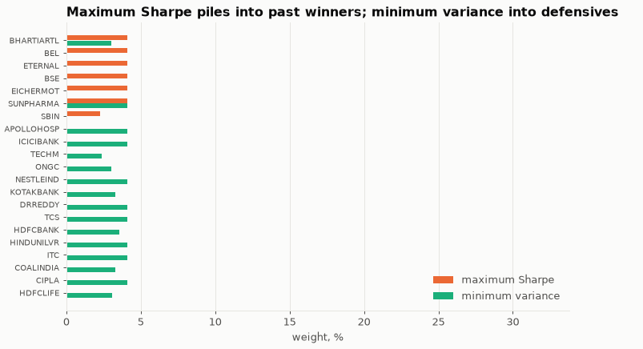
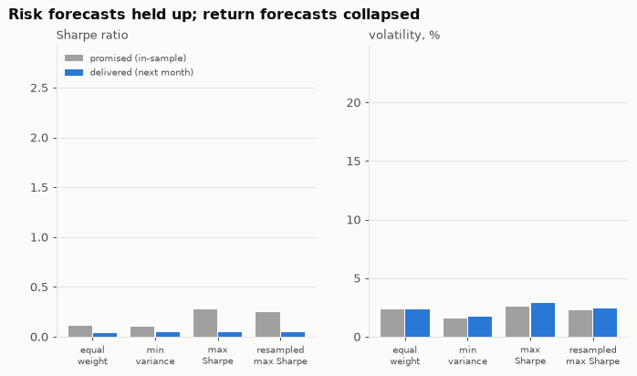
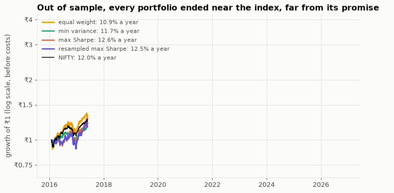

# Efficient Frontier

[](https://github.com/Dhirajdas18/efficient-frontier/actions/workflows/ci.yml)
[](https://dhirajdas18.github.io/efficient-frontier/)

Portfolio construction on NIFTY 50 stocks: the efficient frontier, why the “optimal” portfolio rarely
is, and which way of weighting stocks held up out of sample after costs: equal weight, inverse
volatility, minimum variance, risk parity, maximum Sharpe, shrinkage and Black-Litterman.

**Live dashboard: [dhirajdas18.github.io/efficient-frontier](https://dhirajdas18.github.io/efficient-frontier/)**,
rebuilt weekly by GitHub Actions. Hover the frontier to see what each portfolio holds.

## Features

- [x] Mean-variance maths: portfolio risk, minimum variance, maximum Sharpe, long-only frontier (SLSQP), capital market line
- [x] Estimation error: 130 monthly out-of-sample rebalances on a point-in-time universe; resampling
- [ ] Covariance estimation: sample, Ledoit-Wolf shrinkage, EWMA
- [ ] Walk-forward contest after costs: equal weight, inverse volatility, minimum variance, risk parity, maximum Sharpe
- [ ] Constraints: stock and sector caps, turnover penalty
- [ ] Black-Litterman: market prior plus views
- [ ] Asset classes for an Indian investor: equity, gold, debt, US equity

## Findings

### 1. Looking back, the efficient frontier promises far more than the index delivered

<a href="docs/img/frontier_nifty50.png"><picture><source media="(prefers-reduced-motion: reduce)" srcset="docs/img/frontier_nifty50.png"></picture></a>

Today's 50 NIFTY stocks, daily returns from November 2023 to November 2026 (737 days), annualised. This
is hindsight: the weights are chosen on the same data they are scored on, and today's index members
include stocks that joined because they had risen (BEL, ETERNAL, BSE are among them).

- **One stock is riskier than the index:** the average stock swung 26.8% a year; NIFTY 13.6% and an
  equal-weight portfolio of all 50 stocks 14.3%.
- **The least risky mix:** minimum variance cut volatility to 11.0%, spread over 20 mostly defensive
  stocks (Sun Pharma, Hindustan Unilever, ICICI Bank, ITC, Nestlé).
- **The “optimal” portfolio:** maximum Sharpe returned 41% a year at 19% volatility (Sharpe 1.8,
  against 0.21 for NIFTY and 0.75 for equal weight), but holds only 7 stocks, 32% in Bharti Airtel and
  most of the rest in Bharat Electronics, Eternal, BSE and Eicher: it simply buys the past three years'
  winners. Section 2 tests what such a portfolio did next.

<table><tr>
<td><a href="docs/img/frontier_pair.png"><picture><source media="(prefers-reduced-motion: reduce)" srcset="docs/img/frontier_pair.png"></picture></a></td>
<td><a href="docs/img/frontier_weights.png"><picture><source media="(prefers-reduced-motion: reduce)" srcset="docs/img/frontier_weights.png"></picture></a></td>
</tr></table>

- **Diversification in one picture (left):** HDFC Bank (21% volatility) and Infosys (27%) moved together
  with correlation 0.19, so a 65 / 35 mix swung only 18%, less than either stock alone.
- **What the two optimal portfolios hold (right):** maximum Sharpe concentrates in a handful of
  momentum winners; minimum variance spreads across low-volatility staples and pharma.

### 2. Out of sample, maximum Sharpe promised 2.2 and delivered 0.38; only the risk forecasts held

<a href="docs/img/estimation_promised.png"><picture><source media="(prefers-reduced-motion: reduce)" srcset="docs/img/estimation_promised.png"></picture></a>

Each month from February 2016 to November 2026 (130 rebalances), every portfolio is built from the
previous three years only and held for the next month. The universe has no hindsight: the 50 most-traded
stocks among those with F&O contracts at the time, from NSE's daily bhavcopy (stocks later delisted
included; only results are committed). Before costs.

| | Promised Sharpe | Delivered Sharpe | Delivered return | Delivered volatility | Stocks held |
|---|---|---|---|---|---|
| Equal weight | 0.86 | 0.31 | 11.3% | 19.6% | 50 |
| Minimum variance | 0.80 | **0.42** | 12.0% | 13.9% | 15 |
| Maximum Sharpe | **2.23** | 0.38 | 13.4% | 23.9% | 8 |
| Resampled maximum Sharpe | 2.03 | 0.39 | 13.2% | 20.2% | 19 |
| NIFTY 50 index | | 0.39 | 12.1% | 16.1% | |

- **Return forecasts collapsed:** maximum Sharpe expected 54% a year on its own data and earned 13.4%.
  A stock's past three-year return said nothing about its next month (rank correlation 0.002, t = 0.1):
  with typical stock volatility, a three-year average return has a standard error of 16.6 points a year,
  too wide to tell a 10% stock from a 30% one.
- **Risk forecasts held:** minimum variance expected 13.0% volatility and got 13.9%, the lowest of all
  and the best delivered Sharpe ratio. Risk is far easier to estimate than return.

<table><tr>
<td><a href="docs/img/estimation_growth.png"><picture><source media="(prefers-reduced-motion: reduce)" srcset="docs/img/estimation_growth.png"></picture></a></td>
<td><a href="docs/img/estimation_bootstrap.png"><picture><source media="(prefers-reduced-motion: reduce)" srcset="docs/img/estimation_bootstrap.png"></picture></a></td>
</tr></table>

- **Everything ended near the index (left):** 11.3% to 13.4% a year against NIFTY's 12.1%, with maximum
  Sharpe taking the most risk to get there.
- **The weights are noise (right):** resampling the same three years of data and re-solving, Bharti
  Airtel's maximum-Sharpe weight ranged from 0% to 29%, and was zero in 45% of resamples. Averaging over
  resamples (Michaud) spread the portfolio from 8 to 19 stocks and cut its volatility from 23.9% to 20.2%
  for the same return, but couldn't add information the data doesn't have.

## Quick start

```bash
uv sync
uv run python scripts/fetch_data.py         # Yahoo Finance -> data/prices.parquet
uv run ef report frontier                   # charts -> out/
EF_LAKE_DIR=/path/to/lake uv run ef report estimation   # needs a local NSE bhavcopy lake
uv run python scripts/build_site.py         # dashboard -> site/index.html
uv run pytest
```

## Design

- `src/ef/frontier.py`: portfolio return and risk, minimum variance, maximum Sharpe and the frontier
  (scipy SLSQP, long-only, optional weight caps); maximum Sharpe as the standard convex problem;
  Michaud resampling.
- `src/ef/data.py`: Yahoo prices for today's NIFTY 50 (`docs/data/nifty50.csv`, a snapshot of NSE's
  list; `scripts/fetch_constituents.py` refreshes it). Returns on days Yahoo failed to adjust for a
  corporate action are set to zero (`docs/data/yahoo_fixes.csv`, with sources).
- `src/ef/universe.py`, `walkforward.py`: point-in-time universe from a local NSE bhavcopy lake
  (50 most-traded F&O stocks before each date) and a monthly walk-forward engine (past data only,
  buy-and-hold between rebalances, delisted stocks stay at their last price). Only results are
  committed (`docs/data/estimation_monthly.csv`).
- `src/ef/reports.py`: README findings, reproducible with `ef report <topic>`.
- `src/ef/site.py`, `page.html`: the dashboard, one static page; no server.

MIT licence.
