# Efficient Frontier

[](https://github.com/Dhirajdas18/efficient-frontier/actions/workflows/ci.yml)
[](https://dhirajdas18.github.io/efficient-frontier/)

Portfolio construction on NIFTY 50 stocks: the efficient frontier, why the “optimal” portfolio rarely
is, and which way of weighting stocks held up out of sample after costs: equal weight, inverse
volatility, minimum variance, risk parity, maximum Sharpe, shrinkage and Black-Litterman.

**Live dashboard: [dhirajdas18.github.io/efficient-frontier](https://dhirajdas18.github.io/efficient-frontier/)**,
rebuilt weekly by GitHub Actions. Hover the frontier to see what each portfolio holds.

## Features

- [x] Mean-variance maths: portfolio risk, minimum variance, maximum Sharpe, long-only frontier (SLSQP), capital market line
- [x] Estimation error: 130 monthly out-of-sample rebalances on a point-in-time universe; resampling
- [x] Covariance estimation: sample, Ledoit-Wolf shrinkage (constant correlation), EWMA
- [x] Walk-forward contest after Indian delivery costs: equal weight, inverse volatility (20-day, 1-year), risk parity, minimum variance, maximum Sharpe
- [x] Constraints: stock and sector caps (the reference model's 15% / 30%), turnover penalty
- [x] Black-Litterman: equal-weight prior plus a momentum view weighted by its own track record
- [x] Asset classes for an Indian investor: NIFTY, gold, government bonds, US equity in rupees

## Findings

### 1. In hindsight, the efficient frontier promises far more than the index delivered

<a href="docs/img/frontier_nifty50.png"><picture><source media="(prefers-reduced-motion: reduce)" srcset="docs/img/frontier_nifty50.png">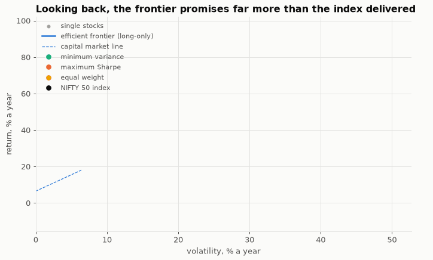</picture></a>

<table><tr>
<td><a href="docs/img/frontier_pair.png"><picture><source media="(prefers-reduced-motion: reduce)" srcset="docs/img/frontier_pair.png">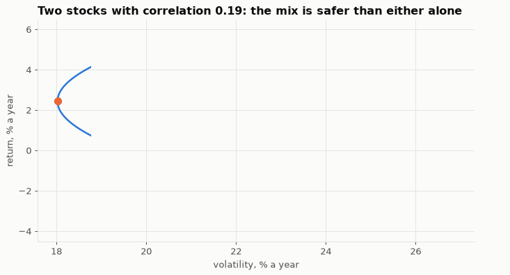</picture></a></td>
<td><a href="docs/img/frontier_weights.png"><picture><source media="(prefers-reduced-motion: reduce)" srcset="docs/img/frontier_weights.png"></picture></a></td>
</tr></table>

Today's 50 NIFTY stocks, daily returns from November 2023 to November 2026 (737 days), annualised. This
is hindsight: the weights are chosen on the same data they are scored on, and today's index members
include stocks that joined because they had risen (BEL, ETERNAL, BSE are among them).

- **One stock is riskier than the index:** the average stock swung 26.8% a year; NIFTY 13.6% and an
  equal-weight portfolio of all 50 stocks 14.3%.
- **The least risky mix:** minimum variance cut volatility to 11.0%, spread over 20 mostly defensive
  stocks (Sun Pharma, Hindustan Unilever, ICICI Bank, ITC, Nestlé).
- **The “optimal” portfolio buys past winners:** maximum Sharpe returned 41% a year at 19% volatility
  (Sharpe 1.8, against 0.21 for NIFTY and 0.75 for equal weight), but holds only 7 stocks, 32% in Bharti
  Airtel and most of the rest in Bharat Electronics, Eternal, BSE and Eicher: it simply buys the past
  three years' winners. Section 2 tests what such a portfolio did next.
- **Diversification in one picture (lower left):** HDFC Bank (21% volatility) and Infosys (27%) moved
  together with correlation 0.19, so a 65 / 35 mix swung only 18%, less than either stock alone.
- **What the two optimal portfolios hold (lower right):** maximum Sharpe concentrates in a handful of
  momentum winners; minimum variance spreads across low-volatility staples and pharma.

### 2. Out of sample, maximum Sharpe's promise collapsed; only the risk forecasts held

<a href="docs/img/estimation_promised.png"><picture><source media="(prefers-reduced-motion: reduce)" srcset="docs/img/estimation_promised.png"></picture></a>

<table><tr>
<td><a href="docs/img/estimation_growth.png"><picture><source media="(prefers-reduced-motion: reduce)" srcset="docs/img/estimation_growth.png"></picture></a></td>
<td><a href="docs/img/estimation_bootstrap.png"><picture><source media="(prefers-reduced-motion: reduce)" srcset="docs/img/estimation_bootstrap.png">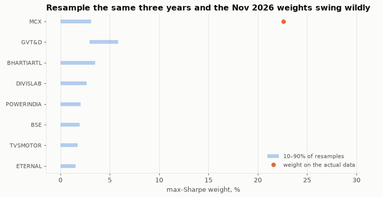</picture></a></td>
</tr></table>

Each month from February 2016 to November 2026 (130 rebalances), every portfolio is built from the
previous three years only and held for the next month. The universe has no hindsight: the 50 most-traded
stocks among those with F&O contracts at the time, from NSE's daily bhavcopy (stocks later delisted
included; only results are committed). Before costs.

| | Promised Sharpe | Delivered Sharpe | Delivered return | Delivered volatility | Stocks held |
|---|---|---|---|---|---|
| Equal weight | 0.86 | 0.30 | 10.9% | 19.4% | 50 |
| Minimum variance | 0.81 | **0.40** | 11.7% | 13.7% | 15 |
| Maximum Sharpe | **2.25** | 0.35 | 12.6% | 23.7% | 8 |
| Resampled maximum Sharpe | 2.04 | 0.36 | 12.5% | 20.0% | 19 |
| NIFTY 50 index | | 0.39 | 12.0% | 16.0% | |

- **Return forecasts collapsed:** maximum Sharpe promised a Sharpe ratio of 2.2 and delivered 0.35; it
  expected an average return of 55% a year on its own data and delivered an average of 14.7% (12.6% a
  year compounded). A stock's past three-year return said nothing about its next month (rank correlation
  0.003, t = 0.1): with typical stock volatility, a three-year average return has a standard error of
  16.7 points a year, too wide to tell a 10% stock from a 30% one.
- **Risk forecasts held:** minimum variance expected 13.0% volatility and got 13.7%, the lowest of all
  and the best delivered Sharpe ratio. Risk is far easier to estimate than return.
- **Everything ended near the index (lower left):** 10.9% to 12.6% a year against NIFTY's 12.0%, with
  maximum Sharpe taking the most risk to get there.
- **The weights are noise (lower right):** resampling the same three years of data and re-solving, Bharti
  Airtel's maximum-Sharpe weight ranged from 0% to 29%, and was zero in 45% of resamples. Averaging over
  resamples (Michaud) spread the portfolio from 8 to 19 stocks and cut its volatility from 23.7% to 20.0%
  for the same return, but couldn't add information the data doesn't have.

### 3. Covariance estimation barely matters long-only; it matters once shorting is allowed

<a href="docs/img/covariance_realised.png"><picture><source media="(prefers-reduced-motion: reduce)" srcset="docs/img/covariance_realised.png"></picture></a>

<table><tr>
<td><a href="docs/img/covariance_forecast.png"><picture><source media="(prefers-reduced-motion: reduce)" srcset="docs/img/covariance_forecast.png">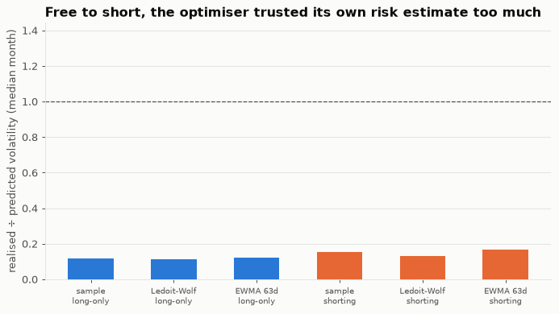</picture></a></td>
<td><a href="docs/img/covariance_shrinkage.png"><picture><source media="(prefers-reduced-motion: reduce)" srcset="docs/img/covariance_shrinkage.png"></picture></a></td>
</tr></table>

The section 2 walk-forward, minimum variance only, with three covariance estimates from the window's
daily returns: the plain sample covariance; Ledoit-Wolf shrinkage toward a constant-correlation target
(each pair pulled toward the average correlation, by an amount estimated from the data); and an
exponentially weighted estimate (63-day half-life). Each is scored by the volatility the portfolio
actually had over the following months (Feb 2016–Nov 2026).

- **Long-only, the estimator made no difference:** 13.7% to 13.8% realised volatility for all three, from
  either three or one year of data, against 19.4% for equal weight. Banning short positions already acts
  as shrinkage (Jagannathan and Ma, 2003): the optimiser can't bet heavily on noisy covariances.
- **With shorting allowed and one year of data, shrinkage helped:** Ledoit-Wolf 13.7% against 14.3% for
  the sample estimate and 14.4% for EWMA, with less leverage (gross exposure 1.77 against 2.23 and 2.38).
- **Free to short, the optimiser believed its own risk estimate too much (lower left):** with one year of
  data, realised volatility came in 27% above the sample estimate's prediction (38% for EWMA), against 7%
  for Ledoit-Wolf. Long-only forecasts were within 9%. An optimiser finds the combinations whose risk
  looks lowest, and some of that is estimation error.
- **How much Ledoit-Wolf shrank (lower right):** a median 16% toward the target with three years of data
  and 27% with one year.

### 4. After costs, returns were a draw; minimum variance cut the risk every year

<a href="docs/img/contest_risk_return.png"><picture><source media="(prefers-reduced-motion: reduce)" srcset="docs/img/contest_risk_return.png">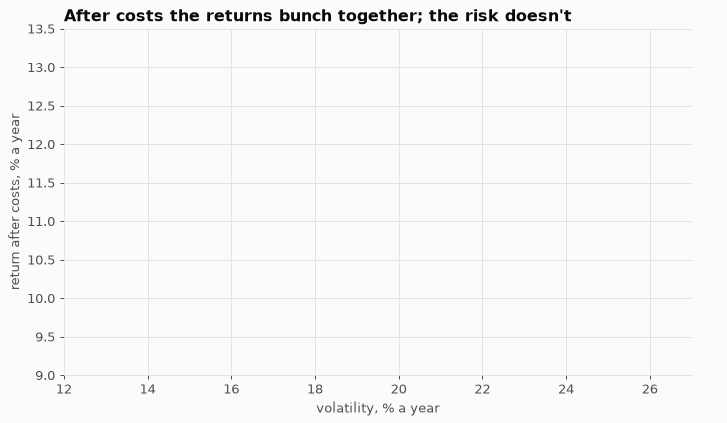</picture></a>

<table><tr>
<td><a href="docs/img/contest_costs.png"><picture><source media="(prefers-reduced-motion: reduce)" srcset="docs/img/contest_costs.png">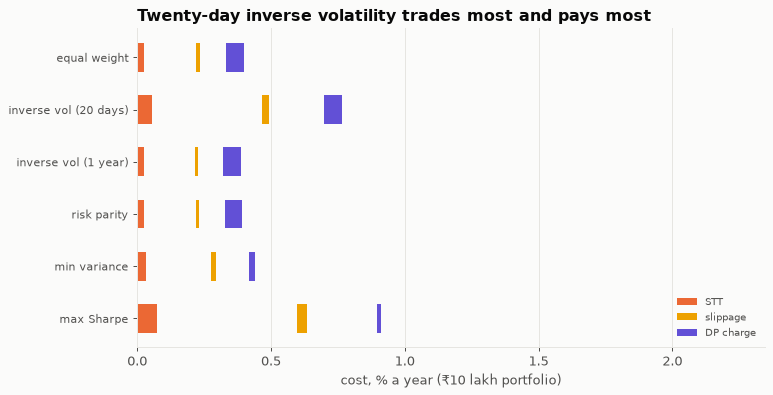</picture></a></td>
<td><a href="docs/img/contest_drawdown.png"><picture><source media="(prefers-reduced-motion: reduce)" srcset="docs/img/contest_drawdown.png"></picture></a></td>
</tr></table>

The section 2 walk-forward (130 monthly rebalances, Feb 2016–Nov 2026, the 50 most-traded F&O stocks at
the time) with six weighting schemes, after Indian delivery costs on a portfolio growing from ₹10 lakh:
STT 0.1% on buys and sells, stamp duty, exchange and SEBI charges with GST, a ₹15.93 depository (DP)
charge per stock sold, and 0.05% slippage each way. Trades are measured from the previous month's
drifted weights. Risk parity and minimum variance use Ledoit-Wolf covariance.

| | Return after costs | Volatility | Worst fall | Turnover a month | Cost a year |
|---|---|---|---|---|---|
| Equal weight | 10.2% | 19.4% | −56% | 8% | 0.70% |
| Inverse volatility, 20 days | 11.5% | 17.8% | −47% | 17% | 1.06% |
| Inverse volatility, 1 year | 11.6% | 17.8% | −46% | 7% | 0.65% |
| Risk parity | 11.1% | 17.3% | −45% | 7% | 0.68% |
| Minimum variance | 11.4% | **13.7%** | **−30%** | 9% | 0.56% |
| Maximum Sharpe | 11.6% | 23.6% | −46% | 19% | 1.01% |
| NIFTY 50 index (no costs) | 12.0% | 16.0% | −38% | | |

- **Returns were a draw:** every scheme ended within 2 points of the others and of NIFTY, and none differed
  from 20-day inverse volatility by more than noise (monthly return differences, |t| < 1).
- **Risk wasn't:** minimum variance had lower volatility than inverse volatility in all 11 calendar years
  and fell 30% at worst (March 2020) against 45–56% for the other stock portfolios.
- **Twenty-day volatility is jumpy, so its weights churn (lower left):** inverse volatility from 20 days
  of data traded 17% of the portfolio a month and cost 1.06% a year; from one year of data it gave the
  same return and risk with 7% turnover and 0.65% cost.
- **On ₹10 lakh, DP charges cost more than STT** for the low-turnover 50-stock schemes (equal weight,
  one-year inverse volatility, risk parity): 0.30–0.35% a year against 0.21–0.22%, because every stock
  trimmed in a month pays ₹15.93. Minimum variance holds about 15 stocks and paid 0.12%.
- **Minimum variance isn't free (lower right):** it fell least in 2020, but by late 2026 it sat furthest
  below its previous peak of all the schemes.

### 5. Caps tamed maximum Sharpe; a turnover penalty cut minimum variance's trading

<a href="docs/img/constraints_caps.png"><picture><source media="(prefers-reduced-motion: reduce)" srcset="docs/img/constraints_caps.png">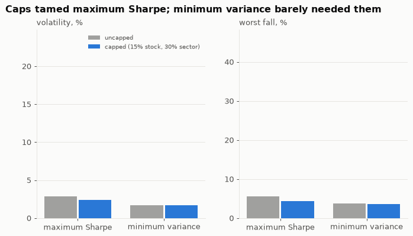</picture></a>

<table><tr>
<td><a href="docs/img/constraints_penalty.png"><picture><source media="(prefers-reduced-motion: reduce)" srcset="docs/img/constraints_penalty.png">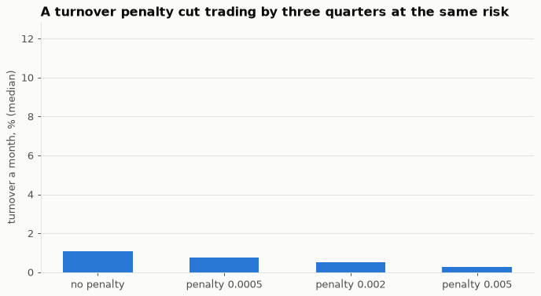</picture></a></td>
<td><a href="docs/img/constraints_sectors.png"><picture><source media="(prefers-reduced-motion: reduce)" srcset="docs/img/constraints_sectors.png">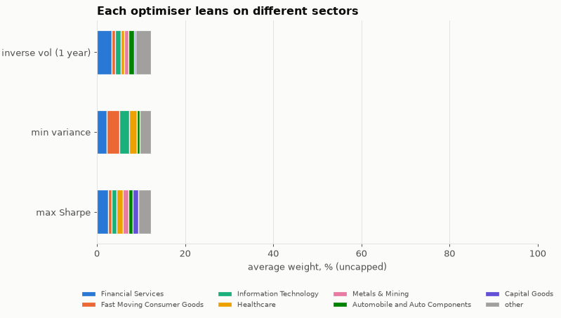</picture></a></td>
</tr></table>

The same walk-forward and costs as section 4, now with the reference model's caps (no stock above 15%, no NSE
industry above 30%; industries from NSE's index lists, with the 11 delisted or merged stocks assigned by
hand, `docs/data/sectors.csv`) and, for minimum variance, a penalty on trading: the optimiser minimises
variance plus λ times the turnover from last month's drifted weights.

- **Caps tamed maximum Sharpe:** volatility fell from 23.6% to 19.9% and the worst fall from −46% to −36%.
  Its return after costs rose from 11.6% to 13.3%, but that difference is noise (monthly t = 0.22).
- **Minimum variance barely needed them:** its largest stock was 17% and largest industry 27% (median)
  even uncapped, so capping left its volatility at 13.7%.
- **A turnover penalty paid for itself (lower left):** at λ = 0.005, median monthly turnover fell by three
  quarters, from 8.9% to 2.1%, and costs from 0.57% to 0.20% a year, with volatility at 13.9% against
  13.7%. All four settings are shown; none was picked on the results.
- **Each scheme leans on different industries (lower right):** minimum variance held 23% in consumer
  staples on average, inverse volatility 27% in financials.

### 6. Black-Litterman kept little of a weak momentum view; buying it outright did worse

<a href="docs/img/bl_returns.png"><picture><source media="(prefers-reduced-motion: reduce)" srcset="docs/img/bl_returns.png">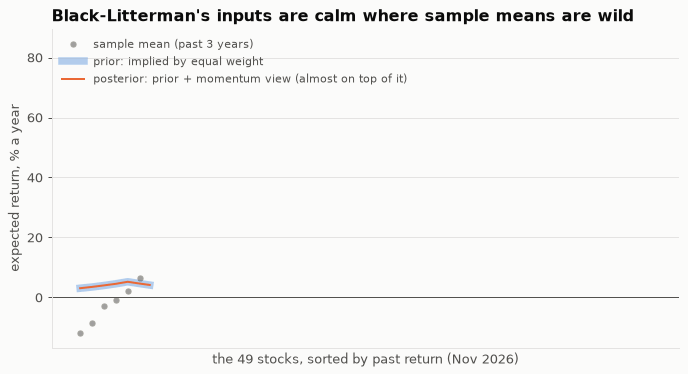</picture></a>

<table><tr>
<td><a href="docs/img/bl_view.png"><picture><source media="(prefers-reduced-motion: reduce)" srcset="docs/img/bl_view.png">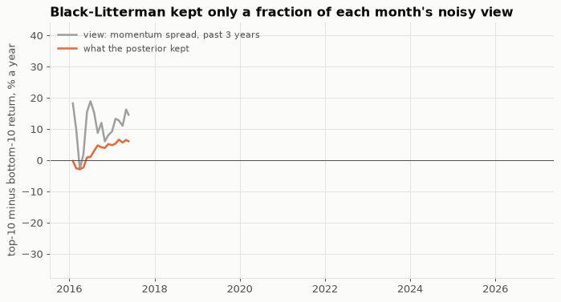</picture></a></td>
<td><a href="docs/img/bl_growth.png"><picture><source media="(prefers-reduced-motion: reduce)" srcset="docs/img/bl_growth.png">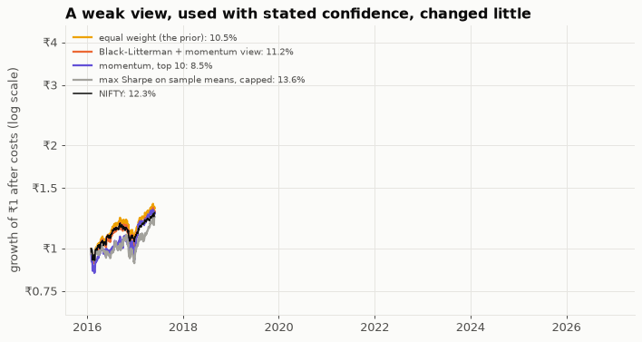</picture></a></td>
</tr></table>

Black-Litterman replaces noisy sample means with a neutral starting point and lets views move it only as
far as their confidence allows. The view is 12-1 momentum: the 10 stocks with the best return over the
past year, skipping the last month, beat the 10 worst. Its size is the average top-minus-bottom spread
over the previous three years, and its confidence the uncertainty of that average. Same walk-forward,
caps and costs as sections 4–5.

| After costs | Return | Volatility | Worst fall | Turnover a month |
|---|---|---|---|---|
| Equal weight (the prior) | 10.2% | 19.4% | −56% | 8% |
| Black-Litterman + momentum view | 11.0% | 19.3% | −48% | 13% |
| Momentum, top 10 stocks | 7.2% | 25.0% | −52% | 31% |
| Maximum Sharpe on sample means, capped | 13.3% | 19.9% | −36% | 18% |
| NIFTY 50 index (no costs) | 12.0% | 16.0% | −38% | |

- **The starting point is equal weight:** the returns that would make an investor hold the equal-weight
  portfolio (market caps aren't available point in time in this data, so equal weight stands in for the
  market portfolio; risk aversion 2.5, τ 0.05).
- **Calm inputs (first chart):** in November 2026 the past three years' sample means ranged from −12% to
  +85% a year; Black-Litterman's expected returns ranged from 3% to 13%.
- **The view was weak (lower left):** across the whole period, momentum ranked next month's returns at
  0.024 (t = 1.08), a top-minus-bottom spread of 3.9% a year (t = 0.51). With three years of noisy
  evidence behind it, the posterior kept a median 6% of each month's view (3% to 10%).
- **Used with stated confidence, the view changed little:** Black-Litterman ended within noise of its
  equal-weight starting point (monthly t = 0.39).
- **Used outright, it cost money:** the 10 momentum stocks turned over 31% a month and returned 7.2% after
  costs, the lowest here. None of the differences from equal weight beat noise (|t| ≤ 0.63).

### 7. Gold and bonds cut a rupee investor's risk far more than return

<a href="docs/img/assets_mixes.png"><picture><source media="(prefers-reduced-motion: reduce)" srcset="docs/img/assets_mixes.png">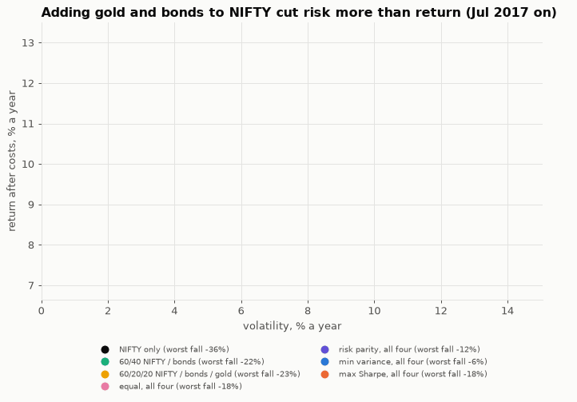</picture></a>

<table><tr>
<td><a href="docs/img/assets_correlation.png"><picture><source media="(prefers-reduced-motion: reduce)" srcset="docs/img/assets_correlation.png">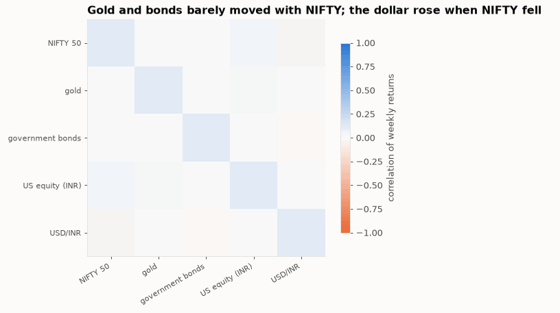</picture></a></td>
<td><a href="docs/img/assets_rupee.png"><picture><source media="(prefers-reduced-motion: reduce)" srcset="docs/img/assets_rupee.png">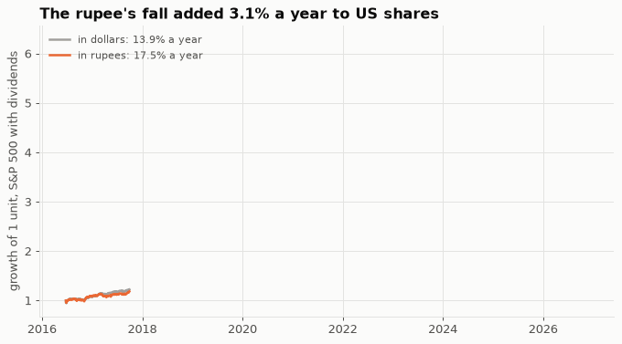</picture></a></td>
</tr></table>

Four asset classes in rupees, June 2016 to November 2026: NIFTY 50 (NIFTYBEES ETF, with dividends), gold
(GOLDBEES ETF), government bonds (NSE's Composite G-Sec total-return index) and US shares (S&P 500 with
dividends, converted at USD/INR); cash is NSE's overnight-rate index (5.4% a year). Mixes rebalance
monthly from July 2017, optimisers estimate from the previous year only, and section 4's costs apply to
every class (slightly overstating costs for gold and bonds). Volatility from weekly returns. Before tax.

| Asset | Return | Volatility | Worst fall | Correlation with NIFTY (weekly) |
|---|---|---|---|---|
| NIFTY 50 | 12.6% | 14.7% | −36% | 1 |
| Gold | 13.8% | 13.9% | −30% | 0.02 |
| Government bonds | 6.9% | 3.7% | −4% | 0.12 |
| US shares in rupees | 17.5% | 17.0% | −30% | 0.39 |

| Mix, after costs (Jul 2017 on) | Return | Volatility | Worst fall |
|---|---|---|---|
| NIFTY only | 12.2% | 15.2% | −36% |
| 60% NIFTY / 40% bonds | 10.1% | 9.4% | −22% |
| 60% NIFTY / 20% bonds / 20% gold | 12.3% | 9.7% | −23% |
| Equal, all four | 13.7% | 8.3% | −18% |
| Risk parity, all four (57% bonds on average) | 9.9% | 5.0% | −12% |
| Minimum variance, all four (84% bonds) | 7.2% | 3.6% | −6% |
| Maximum Sharpe, all four | 8.4% | 9.5% | −18% |

- **Diversification across asset classes worked where stock picking didn't:** 60/20/20 matched NIFTY's
  return with two thirds of the volatility and a −23% worst fall instead of −36%; an equal mix of all four
  did better on all three counts. Gold's weekly correlation with NIFTY was 0.02.
- **Estimation error again:** maximum Sharpe, re-estimated each month from a year of data, had the worst
  return per unit of risk of all the mixes; fixed proportions needed no estimates.
- **The rupee as a cushion (lower right):** the dollar rose 3.1% a year against the rupee, turning the
  S&P 500's 13.9% into 17.5% for a rupee investor, and it tended to rise when NIFTY fell (correlation
  −0.32). From 19 February to 23 March 2020, NIFTY fell 35% and the S&P 500 34% in dollars, but 30% in
  rupees, as the dollar gained 5.7%; gold fell 4.6% and bonds 0.5%.
- **One decade:** gold and US shares had a strong run here. The mixes' risk numbers rest on low
  correlations, which held through this period; their returns depend on which asset had a good decade.

## Quick start

```bash
uv sync
uv run python scripts/fetch_data.py         # Yahoo Finance -> data/prices.parquet
uv run ef report frontier                   # charts -> out/
EF_LAKE_DIR=/path/to/lake uv run ef report estimation   # also: covariance, contest, constraints, black-litterman, assets; needs a local NSE bhavcopy lake
uv run python scripts/build_site.py         # dashboard -> site/index.html
uv run pytest
```

## Design

- `src/ef/frontier.py`: portfolio return and risk, minimum variance, maximum Sharpe and the frontier
  (scipy SLSQP, long-only, optional weight caps); maximum Sharpe as the standard convex problem;
  Michaud resampling; risk parity (Spinu's convex form); stock and sector caps; minimum variance
  with a turnover penalty.
- `src/ef/data.py`: Yahoo prices for today's NIFTY 50 (`docs/data/nifty50.csv`, a snapshot of NSE's
  list; `scripts/fetch_constituents.py` refreshes it). Returns on days Yahoo failed to adjust for a
  corporate action are set to zero (`docs/data/yahoo_fixes.csv`, with sources).
- `src/ef/costs.py`: Indian equity-delivery costs (STT, stamp, exchange, SEBI, GST, DP charge, slippage).
- `src/ef/assets.py`: rupee price series for NIFTY, gold, government bonds, US shares and cash
  (Yahoo plus NSE's bond and overnight-rate indices from the lake; Yahoo's Dec 2019 bad prints removed).
- `src/ef/black_litterman.py`: implied returns, the posterior, and a momentum view sized and weighted
  from the estimation window.
- `src/ef/covariance.py`: sample, Ledoit-Wolf (constant-correlation target) and EWMA covariance.
- `src/ef/universe.py`, `walkforward.py`: point-in-time universe from a local NSE bhavcopy lake
  (50 most-traded F&O stocks before each date) and a monthly walk-forward engine (past data only,
  buy-and-hold between rebalances, delisted stocks stay at their last price). Only results are
  committed (`docs/data/estimation_monthly.csv`).
- `src/ef/reports.py`: README findings, reproducible with `ef report <topic>`.
- `src/ef/site.py`, `page.html`: the dashboard, one static page; no server.

MIT licence.
